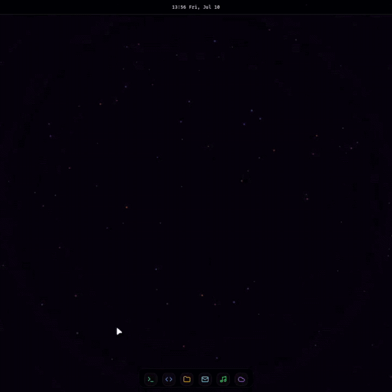
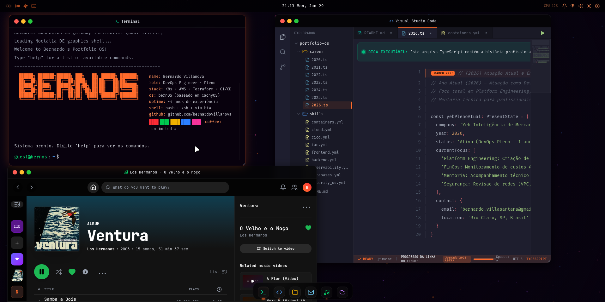
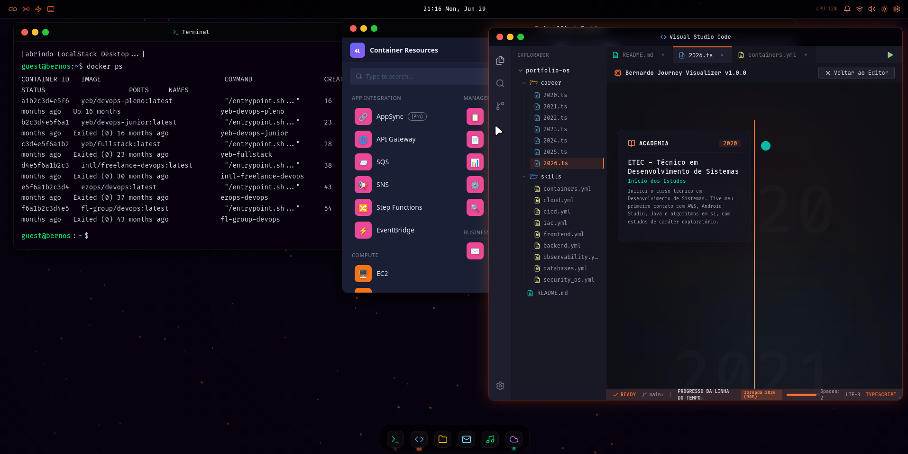

# 🪐 BernOS

Este repositório foi criado especificamente para apresentar o projeto **BernOS** no meu portfólio. Aqui você encontrará uma descrição detalhada de suas funcionalidades, tecnologias utilizadas e capturas de tela do sistema em funcionamento.

---

## 🔗 Link do Projeto

Você pode acessar a versão em produção do BernOS através do link abaixo:

👉 **[Acesse o BernOS aqui](https://bernos.com.br)**

---

## 📸 Demonstração Visual

Abaixo está uma captura de tela da interface principal do BernOS, simulando um ambiente de desktop completo:

---

## 🛠️ Tecnologias Utilizadas

O BernOS foi construído utilizando um conjunto moderno de tecnologias de desenvolvimento web e DevOps:

### Frontend
- **Vue 3**: Framework progressivo em JavaScript para construção de interfaces.
- **TypeScript**: Superset de JavaScript adicionando tipagem estática e segurança ao código.
- **Tailwind CSS**: Framework CSS utilitário para estilização rápida e responsiva.
- **Vite**: Ferramenta de build extremamente rápida para projetos frontend modernos.
- **Lucide Icons**: Biblioteca de ícones elegantes para a interface.

### Backend & Banco de Dados
- **Bun**: Runtime JavaScript/TypeScript rápido e leve para execução do servidor.
- **SQLite**: Banco de dados relacional embutido de alta performance para armazenamento local de dados do portfólio (repositórios, favoritos, etc.).

### Infraestrutura & Deploy
- **Docker & Docker Compose**: Containerização completa da aplicação para consistência entre desenvolvimento e produção.
- **Terraform**: Infraestrutura como Código (IaC) para provisionamento de recursos em nuvem.

---

## 🚀 Funcionalidades Principais

- **Interface de Desktop Realista**: Simulação de um sistema operacional completo com barra de status superior, Dock de aplicativos estilo macOS e suporte a múltiplos modos de janelas.
- **Terminal Interativo**: Um emulador de terminal funcional que executa comandos customizados e exibe informações sobre o projeto.
- **VSCode Editor Simulator**: Um editor de código embutido que exibe trechos de código e explicações sobre a arquitetura do projeto.
- **Files (Gerenciador de Arquivos)**: Navegador de diretórios simulando a organização de projetos e pastas.
- **Mail & Contato**: Integração para facilitar o contato direto por e-mail ou redes sociais.
- **Spotify Player Integration**: Widget de música integrado para complementar o ambiente de trabalho.
- **LocalStack/AWS Integration**: Visualização de recursos de nuvem e curiosidades do DevOps de forma interativa.
- **Responsividade (Layout Mobile)**: Layout otimizado para dispositivos móveis, adaptando o fluxo de janelas para uma experiência de "Home Screen".

---

## 📄 Notas adicionais

Se tiver alguma dúvida ou quiser saber mais sobre a arquitetura por trás do projeto, sinta-se à vontade para entrar em contato comigo pelo [LinkedIn](https://www.linkedin.com/in/bernardo-villanova-de-santana) ou [GitHub](https://github.com/bernardovillanova).
